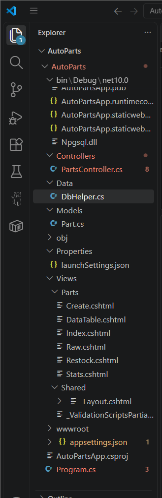
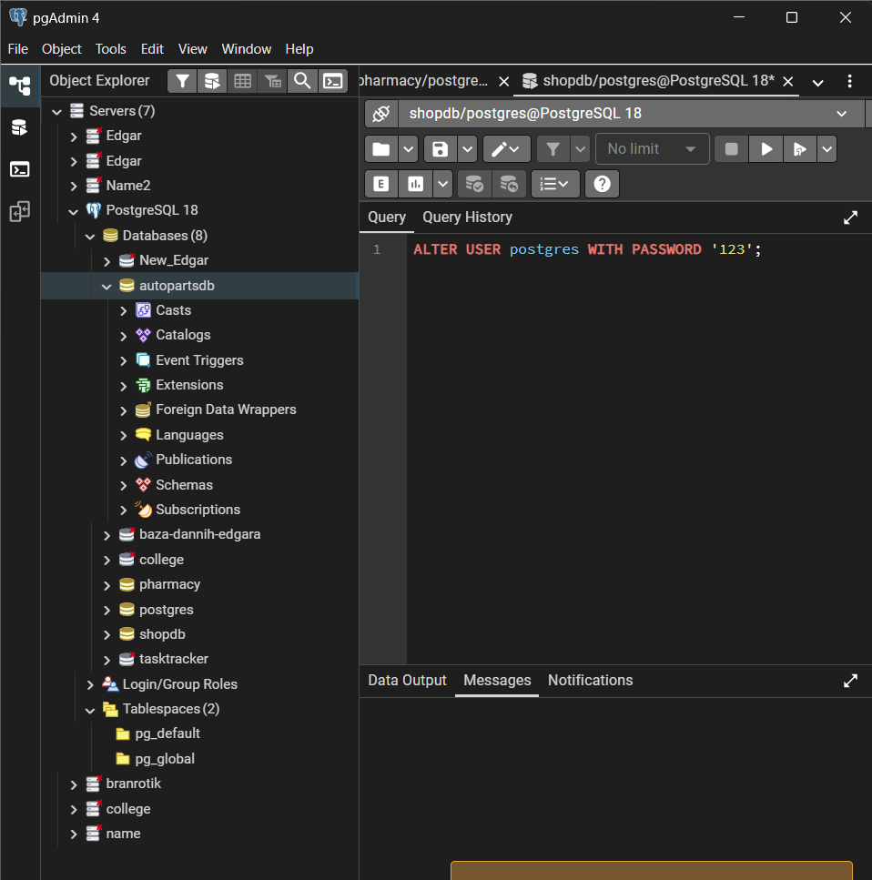
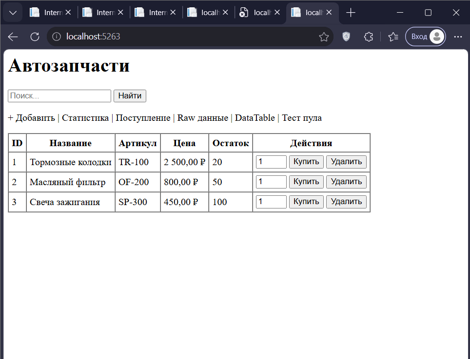

# Проект: Автозапчасти (AutoParts) на ASP.NET Core MVC + PostgreSQL

Этот проект представляет собой веб-приложение для управления складом автозапчастей. В нём реализованы **10 задач по ADO.NET**, охватывающих работу с базой данных через Npgsql (DataReader, DataAdapter, транзакции, асинхронность и пул соединений).

## 📸 Скриншоты работы




## 📂 Структура проекта
```text
AutoParts/
├── Controllers/
│   └── PartsController.cs    # Контроллер для обработки запросов
├── Data/
│   └── DbHelper.cs           # Класс ADO.NET для работы с PostgreSQL
├── Models/
│   └── Part.cs               # Модель запчасти
├── Views/
│   └── Parts/                # Представления
├── Program.cs                # Точка входа и инициализация БД
├── appsettings.json          # Строка подключения к базе
└── AutoPartsApp.csproj       # Файл проекта


🚀 Как запустить
Убедитесь, что у вас установлен и запущен PostgreSQL.

Создайте базу данных autopartsdb (через pgAdmin).

В файле appsettings.json укажите ваш пароль от PostgreSQL (по умолчанию 123).

В терминале выполните:

bash
dotnet run
Перейдите по ссылке, которую выдаст терминал (например, http://localhost:5000).


💻 Исходный код
1. Data/DbHelper.cs


using Npgsql;
using AutoParts.Models;
using System.Data;

namespace AutoParts.Data;

public class DbHelper
{
    private readonly string _connectionString;

    public DbHelper(string connectionString)
    {
        _connectionString = connectionString;
    }

    public void Initialize()
    {
        using var connection = new NpgsqlConnection(_connectionString);
        connection.Open();

        using (var createCmd = new NpgsqlCommand(@"
            CREATE TABLE IF NOT EXISTS parts (
                id          SERIAL PRIMARY KEY,
                name        VARCHAR(200) NOT NULL,
                article     VARCHAR(50),
                price       NUMERIC(18,2) NOT NULL,
                stock       INTEGER NOT NULL DEFAULT 0,
                description VARCHAR(500)
            );
            
            CREATE TABLE IF NOT EXISTS orders (
                id SERIAL PRIMARY KEY,
                part_id INT NOT NULL REFERENCES parts(id),
                quantity INT NOT NULL,
                total NUMERIC(18,2) NOT NULL,
                created_at TIMESTAMP DEFAULT NOW()
            );

            ALTER TABLE parts ADD CONSTRAINT uq_parts_article UNIQUE (article);
        ", connection))
        {
            try { createCmd.ExecuteNonQuery(); } catch { }
        }

        using var checkCmd = new NpgsqlCommand("SELECT COUNT(*) FROM parts", connection);
        var count = Convert.ToInt32(checkCmd.ExecuteScalar());

        if (count == 0)
        {
            using var seedCmd = new NpgsqlCommand(@"
                INSERT INTO parts (name, article, price, stock, description) VALUES
                ('Тормозные колодки', 'TR-100', 2500.00, 20, 'Передние колодки'),
                ('Масляный фильтр', 'OF-200', 800.00, 50, 'Для бензиновых двигателей'),
                ('Свеча зажигания', 'SP-300', 450.00, 100, 'Иридиевая')", connection);
            seedCmd.ExecuteNonQuery();
        }
    }

    public async Task<List<Part>> GetAllPartsAsync()
    {
        var parts = new List<Part>();
        await using var connection = new NpgsqlConnection(_connectionString);
        await connection.OpenAsync();
        await using var cmd = new NpgsqlCommand("SELECT id, name, article, price, stock, description FROM parts ORDER BY id", connection);
        await using var reader = await cmd.ExecuteReaderAsync();
        while (await reader.ReadAsync())
        {
            parts.Add(new Part
            {
                Id = reader.GetInt32(0),
                Name = reader.GetString(1),
                Article = reader.IsDBNull(2) ? "" : reader.GetString(2),
                Price = reader.GetDecimal(3),
                Stock = reader.GetInt32(4),
                Description = reader.IsDBNull(5) ? null : reader.GetString(5)
            });
        }
        return parts;
    }

    public async Task<List<Part>> SearchPartsAsync(string query)
    {
        if (string.IsNullOrWhiteSpace(query)) return await GetAllPartsAsync();
        var parts = new List<Part>();
        await using var connection = new NpgsqlConnection(_connectionString);
        await connection.OpenAsync();
        await using var cmd = new NpgsqlCommand("SELECT * FROM parts WHERE name ILIKE @q OR article ILIKE @q", connection);
        cmd.Parameters.AddWithValue("@q", $"%{query}%");
        await using var reader = await cmd.ExecuteReaderAsync();
        while (await reader.ReadAsync())
        {
            parts.Add(new Part
            {
                Id = reader.GetInt32(0),
                Name = reader.GetString(1),
                Article = reader.IsDBNull(2) ? "" : reader.GetString(2),
                Price = reader.GetDecimal(3),
                Stock = reader.GetInt32(4),
                Description = reader.IsDBNull(5) ? null : reader.GetString(5)
            });
        }
        return parts;
    }

    public async Task<bool> DeletePartAsync(int id)
    {
        await using var connection = new NpgsqlConnection(_connectionString);
        await connection.OpenAsync();
        await using var cmd = new NpgsqlCommand("DELETE FROM parts WHERE id = @id", connection);
        cmd.Parameters.AddWithValue("@id", id);
        return await cmd.ExecuteNonQueryAsync() > 0;
    }

    public async Task<(int, decimal, decimal)> GetStatsAsync()
    {
        await using var connection = new NpgsqlConnection(_connectionString);
        await connection.OpenAsync();
        await using var cmd = new NpgsqlCommand("SELECT COUNT(*), COALESCE(SUM(price*stock),0), COALESCE(AVG(price),0) FROM parts", connection);
        await using var reader = await cmd.ExecuteReaderAsync();
        if (await reader.ReadAsync()) return (reader.GetInt32(0), reader.GetDecimal(1), reader.GetDecimal(2));
        return (0, 0, 0);
    }

    public async Task<bool> PlaceOrderAsync(int partId, int quantity)
    {
        await using var connection = new NpgsqlConnection(_connectionString);
        await connection.OpenAsync();
        await using var tx = await connection.BeginTransactionAsync();
        try
        {
            await using var checkCmd = new NpgsqlCommand("SELECT price, stock FROM parts WHERE id = @id", connection, tx);
            checkCmd.Parameters.AddWithValue("@id", partId);
            await using var reader = await checkCmd.ExecuteReaderAsync();
            if (!await reader.ReadAsync()) { await tx.RollbackAsync(); return false; }
            
            decimal price = reader.GetDecimal(0);
            int stock = reader.GetInt32(1);
            await reader.CloseAsync();

            if (stock < quantity) { await tx.RollbackAsync(); return false; }

            await using var insertCmd = new NpgsqlCommand("INSERT INTO orders (part_id, quantity, total) VALUES (@partId, @qty, @total)", connection, tx);
            insertCmd.Parameters.AddWithValue("@partId", partId);
            insertCmd.Parameters.AddWithValue("@qty", quantity);
            insertCmd.Parameters.AddWithValue("@total", price * quantity);
            await insertCmd.ExecuteNonQueryAsync();

            await using var updateCmd = new NpgsqlCommand("UPDATE parts SET stock = stock - @qty WHERE id = @id", connection, tx);
            updateCmd.Parameters.AddWithValue("@qty", quantity);
            updateCmd.Parameters.AddWithValue("@id", partId);
            await updateCmd.ExecuteNonQueryAsync();

            await tx.CommitAsync();
            return true;
        }
        catch
        {
            await tx.RollbackAsync();
            return false;
        }
    }

    public async Task<bool> RestockAsync(List<(int PartId, int AddQty)> items)
    {
        await using var connection = new NpgsqlConnection(_connectionString);
        await connection.OpenAsync();
        await using var tx = await connection.BeginTransactionAsync();
        try
        {
            foreach (var item in items)
            {
                await using var cmd = new NpgsqlCommand("UPDATE parts SET stock = stock + @qty WHERE id = @id", connection, tx);
                cmd.Parameters.AddWithValue("@qty", item.AddQty);
                cmd.Parameters.AddWithValue("@id", item.PartId);
                if (await cmd.ExecuteNonQueryAsync() == 0) { await tx.RollbackAsync(); return false; }
            }
            await tx.CommitAsync(); return true;
        }
        catch { await tx.RollbackAsync(); return false; }
    }

    public async Task<List<Dictionary<string, object?>>> GetRawPartsAsync()
    {
        var result = new List<Dictionary<string, object?>>();
        await using var connection = new NpgsqlConnection(_connectionString);
        await connection.OpenAsync();
        await using var cmd = new NpgsqlCommand("SELECT * FROM parts", connection);
        await using var reader = await cmd.ExecuteReaderAsync();
        while (await reader.ReadAsync())
        {
            var row = new Dictionary<string, object?>();
            for (int i = 0; i < reader.FieldCount; i++)
                row[reader.GetName(i)] = reader.IsDBNull(i) ? null : reader.GetValue(i);
            result.Add(row);
        }
        return result;
    }

    public DataTable GetPartsDataTable()
    {
        using var connection = new NpgsqlConnection(_connectionString);
        connection.Open();
        using var adapter = new NpgsqlDataAdapter("SELECT * FROM parts", connection);
        var dt = new DataTable();
        adapter.Fill(dt);
        return dt;
    }

    public async Task<(bool Ok, string? Error)> TryAddPartAsync(Part part)
    {
        await using var connection = new NpgsqlConnection(_connectionString);
        await connection.OpenAsync();
        await using var cmd = new NpgsqlCommand("INSERT INTO parts (name, article, price, stock, description) VALUES (@name, @article, @price, @stock, @description)", connection);
        cmd.Parameters.AddWithValue("@name", part.Name);
        cmd.Parameters.AddWithValue("@article", part.Article);
        cmd.Parameters.AddWithValue("@price", part.Price);
        cmd.Parameters.AddWithValue("@stock", part.Stock);
        cmd.Parameters.AddWithValue("@description", (object?)part.Description ?? DBNull.Value);
        try
        {
            await cmd.ExecuteNonQueryAsync();
            return (true, null);
        }
        catch (PostgresException ex) when (ex.SqlState == "23505")
        {
            return (false, "Запчасть с таким артикулом уже существует.");
        }
    }

    public async Task<string> PoolTestAsync()
    {
        var tasks = Enumerable.Range(0, 20).Select(async _ =>
        {
            await using var conn = new NpgsqlConnection(_connectionString);
            await conn.OpenAsync();
            await using var cmd = new NpgsqlCommand("SELECT 1", conn);
            await cmd.ExecuteScalarAsync();
        });
        var sw = System.Diagnostics.Stopwatch.StartNew();
        await Task.WhenAll(tasks);
        sw.Stop();
        return $"20 запросов выполнено за {sw.ElapsedMilliseconds} мс. (Пул ограничен Maximum Pool Size=5)";
    }
}

2. Controllers/PartsController.cs

using Microsoft.AspNetCore.Mvc;
using AutoParts.Data;
using AutoParts.Models;

namespace AutoParts.Controllers;

public class PartsController : Controller
{
    private readonly DbHelper _db;
    public PartsController(DbHelper db) => _db = db;

    public async Task<IActionResult> Index(string? searchString)
    {
        var parts = string.IsNullOrEmpty(searchString) 
            ? await _db.GetAllPartsAsync() 
            : await _db.SearchPartsAsync(searchString);
        ViewData["CurrentFilter"] = searchString;
        return View(parts);
    }

    public IActionResult Create() => View();

    [HttpPost]
    [ValidateAntiForgeryToken]
    public async Task<IActionResult> Create(Part part)
    {
        if (ModelState.IsValid)
        {
            var (ok, error) = await _db.TryAddPartAsync(part);
            if (ok) return RedirectToAction(nameof(Index));
            ModelState.AddModelError("Article", error!);
        }
        return View(part);
    }

    [HttpPost]
    [ValidateAntiForgeryToken]
    public async Task<IActionResult> Delete(int id)
    {
        var ok = await _db.DeletePartAsync(id);
        TempData["Message"] = ok ? "Запчасть удалена." : "Запчасть не найдена.";
        return RedirectToAction(nameof(Index));
    }

    [HttpPost]
    [ValidateAntiForgeryToken]
    public async Task<IActionResult> Buy(int id, int quantity = 1)
    {
        var ok = await _db.PlaceOrderAsync(id, quantity);
        TempData["Message"] = ok ? "Заказ оформлен!" : "Недостаточно товара на складе.";
        return RedirectToAction(nameof(Index));
    }

    public async Task<IActionResult> Stats()
    {
        var (totalParts, totalValue, avgPrice) = await _db.GetStatsAsync();
        ViewData["TotalParts"] = totalParts;
        ViewData["TotalValue"] = totalValue;
        ViewData["AvgPrice"] = avgPrice;
        return View();
    }

    public IActionResult Restock() => View();

    [HttpPost]
    public async Task<IActionResult> Restock(int[] partIds, int[] quantities)
    {
        var items = new List<(int, int)>();
        for (int i = 0; i < partIds.Length; i++)
            if (partIds[i] > 0 && quantities[i] > 0)
                items.Add((partIds[i], quantities[i]));

        var ok = await _db.RestockAsync(items);
        TempData["Message"] = ok ? "Поступление оформлено." : "Ошибка: запчасть не найдена. Откат.";
        return RedirectToAction(nameof(Index));
    }

    public async Task<IActionResult> Raw() => View(await _db.GetRawPartsAsync());

    public IActionResult DataTable() => View(_db.GetPartsDataTable());

    public async Task<IActionResult> PoolTest()
    {
        var result = await _db.PoolTestAsync();
        return Content(result);
    }
}

3. Models/Part.cs

namespace AutoParts.Models;

public class Part
{
    public int Id { get; set; }
    public string Name { get; set; } = string.Empty;
    public string Article { get; set; } = string.Empty;
    public decimal Price { get; set; }
    public int Stock { get; set; }
    public string? Description { get; set; }
}

4. Program.cs

using AutoParts.Data;

var builder = WebApplication.CreateBuilder(args);
builder.Services.AddControllersWithViews();

var connectionString = builder.Configuration.GetConnectionString("Default")!;
builder.Services.AddSingleton(new DbHelper(connectionString));

var app = builder.Build();

using (var scope = app.Services.CreateScope())
{
    var db = scope.ServiceProvider.GetRequiredService<DbHelper>();
    db.Initialize();
    Console.WriteLine("База данных инициализирована.");
}

app.UseStaticFiles();
app.UseRouting();
app.MapControllerRoute(name: "default", pattern: "{controller=Parts}/{action=Index}/{id?}");
app.Run();

5. appsettings.json

{
  "ConnectionStrings": {
    "Default": "Host=localhost;Port=5432;Database=autopartsdb;Username=postgres;Password=123;Maximum Pool Size=5;Minimum Pool Size=1;"
  },
  "Logging": {
    "LogLevel": {
      "Default": "Information",
      "Microsoft.AspNetCore": "Warning"
    }
  },
  "AllowedHosts": "*"
}


6. Views/Parts/Index.cshtml

@model List<AutoParts.Models.Part>
@{
    ViewData["Title"] = "Автозапчасти";
    var msg = TempData["Message"] as string;
}

<h1>Автозапчасти</h1>

@if (!string.IsNullOrEmpty(msg))
{
    <div style="padding:10px; background:#e7f5e7; border:1px solid #3c3; margin:10px 0;">@msg</div>
}

<form method="get" asp-action="Index">
    <input type="text" name="searchString" value="@ViewData["CurrentFilter"]" placeholder="Поиск..." />
    <button type="submit">Найти</button>
</form>

<p>
    <a asp-action="Create">+ Добавить</a> | 
    <a asp-action="Stats">Статистика</a> | 
    <a asp-action="Restock">Поступление</a> | 
    <a asp-action="Raw">Raw данные</a> | 
    <a asp-action="DataTable">DataTable</a> |
    <a asp-action="PoolTest">Тест пула</a>
</p>

<table border="1" cellpadding="5" cellspacing="0">
    <tr>
        <th>ID</th><th>Название</th><th>Артикул</th><th>Цена</th><th>Остаток</th><th>Действия</th>
    </tr>
    @foreach (var p in Model)
    {
        <tr>
            <td>@p.Id</td>
            <td>@p.Name</td>
            <td>@p.Article</td>
            <td>@p.Price.ToString("C")</td>
            <td>@p.Stock</td>
            <td>
                <form asp-action="Buy" method="post" style="display:inline;">
                    @Html.AntiForgeryToken()
                    <input type="hidden" name="id" value="@p.Id" />
                    <input type="number" name="quantity" value="1" min="1" max="@p.Stock" style="width:50px;" />
                    <button type="submit" @(p.Stock == 0 ? "disabled" : "")>Купить</button>
                </form>
                
                <form asp-action="Delete" method="post" style="display:inline;" onsubmit="return confirm('Удалить запчасть?');">
                    @Html.AntiForgeryToken()
                    <input type="hidden" name="id" value="@p.Id" />
                    <button type="submit">Удалить</button>
                </form>
            </td>
        </tr>
    }
</table>

7. Views/Parts/Create.cshtml

@model AutoParts.Models.Part
@{
    ViewData["Title"] = "Добавить запчасть";
}

<h1>Добавить запчасть</h1>

<form asp-action="Create" method="post">
    @Html.AntiForgeryToken()
    <p>
        <label>Название</label><br />
        <input asp-for="Name" required maxlength="200" />
    </p>
    <p>
        <label>Артикул</label><br />
        <input asp-for="Article" required maxlength="50" />
        <span asp-validation-for="Article" style="color:red;"></span>
    </p>
    <p>
        <label>Цена</label><br />
        <input asp-for="Price" type="number" step="0.01" min="0" required />
    </p>
    <p>
        <label>Остаток</label><br />
        <input asp-for="Stock" type="number" min="0" required />
    </p>
    <p>
        <label>Описание</label><br />
        <textarea asp-for="Description" maxlength="500"></textarea>
    </p>
    <button type="submit">Сохранить</button>
    <a asp-action="Index">Отмена</a>
</form>


8. Views/Parts/Stats.cshtml

<h1>Статистика склада</h1>
<ul>
    <li>Всего запчастей: @ViewData["TotalParts"]</li>
    <li>Общая стоимость: @(((decimal)ViewData["TotalValue"]!).ToString("C"))</li>
    <li>Средняя цена: @(((decimal)ViewData["AvgPrice"]!).ToString("C"))</li>
</ul>
<a asp-action="Index">Назад</a>


9. Views/Parts/Restock.cshtml

<h1>Поступление товара</h1>
<form asp-action="Restock" method="post">
    <p>ID запчасти: <input type="number" name="partIds" value="1" /> Кол-во: <input type="number" name="quantities" value="10" /></p>
    <p>ID запчасти: <input type="number" name="partIds" value="2" /> Кол-во: <input type="number" name="quantities" value="5" /></p>
    <button type="submit">Оприходовать</button>
</form>
<a asp-action="Index">Назад</a>

10. Views/Parts/Raw.cshtml

@model List<Dictionary<string, object?>>
@{
    ViewData["Title"] = "Сырые данные";
}

<h1>Сырое чтение (DataReader)</h1>
<table border="1" cellpadding="8">
    <tr>
        @if (Model.Count > 0)
        {
            @foreach (var key in Model[0].Keys)
            {
                <th>@key</th>
            }
        }
    </tr>
    @foreach (var row in Model)
    {
        <tr>
            @foreach (var val in row.Values)
            {
                <td>@val</td>
            }
        </tr>
    }
</table>
<a asp-action="Index">Назад</a>

11. Views/Parts/DataTable.cshtml

@model System.Data.DataTable
@{
    ViewData["Title"] = "DataTable";
}

<h1>Таблица через DataAdapter</h1>
<table border="1" cellpadding="8">
    <tr>
        @foreach (System.Data.DataColumn col in Model.Columns)
        {
            <th>@col.ColumnName</th>
        }
    </tr>
    @foreach (System.Data.DataRow row in Model.Rows)
    {
        <tr>
            @foreach (var item in row.ItemArray)
            {
                <td>@item</td>
            }
        </tr>
    }
</table>
<a asp-action="Index">Назад</a>





что получилось 

