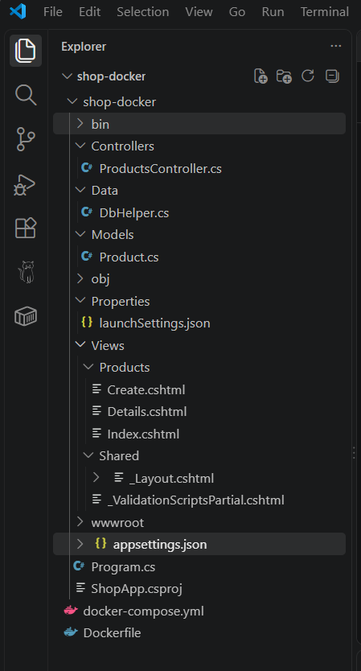
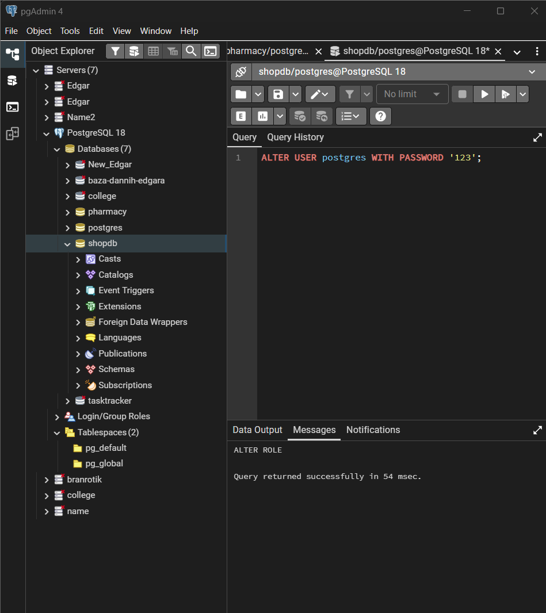
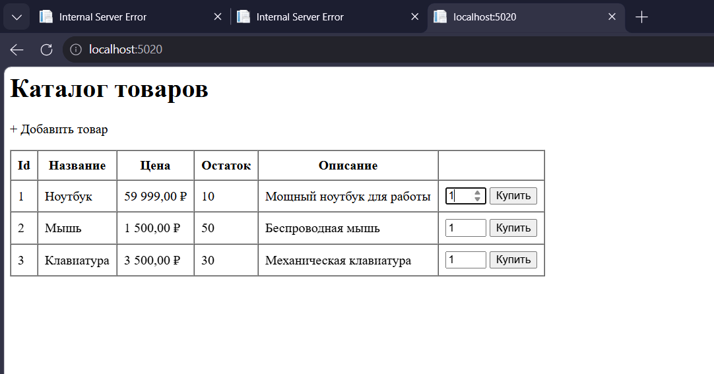

# Проект: Магазин (ShopApp) на ASP.NET Core MVC + PostgreSQL

Данный проект представляет собой веб-приложение (каталог товаров) с возможностью просмотра, добавления товаров и симуляции покупки (уменьшения остатка на складе). Приложение использует ADO.NET (Npgsql) для работы с базой данных PostgreSQL и полностью контейнеризировано с помощью Docker.


## 📂 Структура проекта
```text
shop-docker/
├── docker-compose.yml      # Конфигурация Docker (PostgreSQL + Web)
├── Dockerfile              # Инструкция сборки контейнера приложения
├── ShopApp.csproj          # Файл проекта (зависимости)
├── Program.cs              # Точка входа и настройка DI
├── appsettings.json        # Строка подключения к БД
├── Controllers/
│   └── ProductsController.cs # Обработка HTTP-запросов
├── Models/
│   └── Product.cs          # Модель данных
├── Data/
│   └── DbHelper.cs         # Слой работы с БД (ADO.NET)
└── Views/
    └── Products/
        ├── Index.cshtml    # Список товаров
        ├── Details.cshtml  # Детали товара
        └── Create.cshtml   # Форма добавления


Вариант 1: Через Docker (рекомендуется)
Убедитесь, что у вас запущен Docker Desktop. В терминале выполните:

bash
docker compose up --build
После сборки сайт будет доступен по адресу: http://localhost:8080

Вариант 2: Локальный запуск
Создайте базу данных shopdb в PostgreSQL.

В файле appsettings.json укажите ваш пароль от пользователя postgres.

Выполните в терминале:

dotnet run


💻 Исходный код
1. docker-compose.yml

services:
  db:
    image: postgres:16-alpine
    environment:
      POSTGRES_DB: shopdb
      POSTGRES_USER: shopuser
      POSTGRES_PASSWORD: 12345
    ports:
      - "5434:5432"
    volumes:
      - pgdata:/var/lib/postgresql/data
    healthcheck:
      test: ["CMD-SHELL", "pg_isready -U shopuser -d shopdb"]
      interval: 5s
      timeout: 5s
      retries: 10
      start_period: 10s

  web:
    build: .
    ports:
      - "8080:8080"
    environment:
      - ASPNETCORE_ENVIRONMENT=Production
      - ConnectionStrings__Default=Host=db;Port=5432;Database=shopdb;Username=shopuser;Password=12345;SslMode=Disable;
    depends_on:
      db:
        condition: service_healthy

volumes:
  pgdata:

2. Dockerfile

FROM mcr.microsoft.com/dotnet/sdk:8.0 AS build
WORKDIR /src
COPY *.csproj .
RUN dotnet restore
COPY . .
RUN dotnet publish -c Release -o /app/publish
RUN apt-get update && apt-get install -y libgssapi-krb5-2

FROM mcr.microsoft.com/dotnet/aspnet:8.0
WORKDIR /app
COPY --from=build /app/publish .
EXPOSE 8080
ENV ASPNETCORE_URLS=http://+:8080
ENTRYPOINT ["dotnet", "ShopApp.dll"]

3. Models/Product.cs

namespace ShopApp.Models;

public class Product
{
    public int Id { get; set; }
    public string Name { get; set; } = string.Empty;
    public decimal Price { get; set; }
    public int Stock { get; set; }
    public string? Description { get; set; }
}

4. Data/DbHelper.cs

using Npgsql;
using ShopApp.Models;

namespace ShopApp.Data;

public class DbHelper
{
    private readonly string _connectionString;

    public DbHelper(string connectionString)
    {
        _connectionString = connectionString;
    }

    public void Initialize()
    {
        using var connection = new NpgsqlConnection(_connectionString);
        connection.Open();

        using (var createCmd = new NpgsqlCommand(@"
            CREATE TABLE IF NOT EXISTS products (
                id          SERIAL PRIMARY KEY,
                name        VARCHAR(200) NOT NULL,
                price       NUMERIC(18,2) NOT NULL,
                stock       INTEGER NOT NULL DEFAULT 0,
                description VARCHAR(500)
            )", connection))
        {
            createCmd.ExecuteNonQuery();
        }

        using var checkCmd = new NpgsqlCommand("SELECT COUNT(*) FROM products", connection);
        var count = Convert.ToInt32(checkCmd.ExecuteScalar());

        if (count == 0)
        {
            using var seedCmd = new NpgsqlCommand(@"
                INSERT INTO products (name, price, stock, description) VALUES
                ('Ноутбук', 59999.00, 10, 'Мощный ноутбук для работы'),
                ('Мышь', 1500.00, 50, 'Беспроводная мышь'),
                ('Клавиатура', 3500.00, 30, 'Механическая клавиатура')", connection);
            seedCmd.ExecuteNonQuery();
        }
    }

    public List<Product> GetAllProducts()
    {
        var products = new List<Product>();
        using var connection = new NpgsqlConnection(_connectionString);
        connection.Open();

        using var cmd = new NpgsqlCommand(
            "SELECT id, name, price, stock, description FROM products ORDER BY id",
            connection);
        using var reader = cmd.ExecuteReader();

        while (reader.Read())
        {
            products.Add(new Product
            {
                Id = reader.GetInt32(0),
                Name = reader.GetString(1),
                Price = reader.GetDecimal(2),
                Stock = reader.GetInt32(3),
                Description = reader.IsDBNull(4) ? null : reader.GetString(4)
            });
        }
        return products;
    }

    public Product? GetProductById(int id)
    {
        using var connection = new NpgsqlConnection(_connectionString);
        connection.Open();

        using var cmd = new NpgsqlCommand(
            "SELECT id, name, price, stock, description FROM products WHERE id = @id",
            connection);
        cmd.Parameters.AddWithValue("@id", id);

        using var reader = cmd.ExecuteReader();
        if (reader.Read())
        {
            return new Product
            {
                Id = reader.GetInt32(0),
                Name = reader.GetString(1),
                Price = reader.GetDecimal(2),
                Stock = reader.GetInt32(3),
                Description = reader.IsDBNull(4) ? null : reader.GetString(4)
            };
        }
        return null;
    }

    public void AddProduct(Product product)
    {
        using var connection = new NpgsqlConnection(_connectionString);
        connection.Open();

        using var cmd = new NpgsqlCommand(@"
            INSERT INTO products (name, price, stock, description)
            VALUES (@name, @price, @stock, @description)", connection);
        cmd.Parameters.AddWithValue("@name", product.Name);
        cmd.Parameters.AddWithValue("@price", product.Price);
        cmd.Parameters.AddWithValue("@stock", product.Stock);
        cmd.Parameters.AddWithValue("@description", (object?)product.Description ?? DBNull.Value);

        cmd.ExecuteNonQuery();
    }

    public bool DecreaseStock(int productId, int quantity)
    {
        using var connection = new NpgsqlConnection(_connectionString);
        connection.Open();

        using var cmd = new NpgsqlCommand(@"
            UPDATE products
            SET stock = stock - @qty
            WHERE id = @id AND stock >= @qty", connection);
        cmd.Parameters.AddWithValue("@id", productId);
        cmd.Parameters.AddWithValue("@qty", quantity);

        return cmd.ExecuteNonQuery() > 0;
    }
}

5. Controllers/ProductsController.cs

using Microsoft.AspNetCore.Mvc;
using ShopApp.Data;
using ShopApp.Models;

namespace ShopApp.Controllers;

public class ProductsController : Controller
{
    private readonly DbHelper _db;

    public ProductsController(DbHelper db)
    {
        _db = db;
    }

    public IActionResult Index()
    {
        var products = _db.GetAllProducts();
        return View(products);
    }

    public IActionResult Details(int id)
    {
        var product = _db.GetProductById(id);
        if (product == null) return NotFound();
        return View(product);
    }

    public IActionResult Create() => View();

    [HttpPost]
    [ValidateAntiForgeryToken]
    public IActionResult Create(Product product)
    {
        if (ModelState.IsValid)
        {
            _db.AddProduct(product);
            return RedirectToAction(nameof(Index));
        }
        return View(product);
    }

    [HttpPost]
    public IActionResult Buy(int id, int quantity = 1)
    {
        var success = _db.DecreaseStock(id, quantity);
        TempData["Message"] = success
            ? $"Товар куплен! Остаток уменьшен на {quantity}."
            : "Недостаточно товара на складе.";
        return RedirectToAction(nameof(Index));
    }
}

6. Program.cs

using ShopApp.Data;

var builder = WebApplication.CreateBuilder(args);

builder.Services.AddControllersWithViews();

var connectionString = builder.Configuration.GetConnectionString("Default")
    ?? throw new InvalidOperationException("Connection string not found");

builder.Services.AddSingleton(new DbHelper(connectionString));

var app = builder.Build();

using (var scope = app.Services.CreateScope())
{
    var db = scope.ServiceProvider.GetRequiredService<DbHelper>();
    var retries = 10;
    while (retries > 0)
    {
        try
        {
            db.Initialize();
            Console.WriteLine("База данных инициализирована.");
            break;
        }
        catch (Exception ex)
        {
            retries--;
            Console.WriteLine($"Ожидание PostgreSQL... Осталось попыток: {retries}. {ex.Message}");
            Thread.Sleep(3000);
        }
    }
}

app.UseStaticFiles();
app.UseRouting();

app.MapControllerRoute(
    name: "default",
    pattern: "{controller=Products}/{action=Index}/{id?}");

app.Run();

7. appsettings.json
{
  "ConnectionStrings": {
    "Default": "Host=localhost;Port=5432;Database=shopdb;Username=postgres;Password=123"
  },
  "Logging": {
    "LogLevel": {
      "Default": "Information",
      "Microsoft.AspNetCore": "Warning"
    }
  },
  "AllowedHosts": "*"
}

8. Views/Products/Index.cshtml

@model List<ShopApp.Models.Product>
@{
    ViewData["Title"] = "Каталог товаров";
    var message = TempData["Message"] as string;
}

<h1>Каталог товаров</h1>

@if (!string.IsNullOrEmpty(message))
{
    <div style="padding:10px; background:#e7f5e7; border:1px solid #3c3; margin:10px 0;">
        @message
    </div>
}

<p>
    <a asp-action="Create">+ Добавить товар</a>
</p>

<table border="1" cellpadding="8" cellspacing="0">
    <tr>
        <th>Id</th><th>Название</th><th>Цена</th><th>Остаток</th><th>Описание</th><th></th>
    </tr>
    @foreach (var p in Model)
    {
        <tr>
            <td>@p.Id</td>
            <td><a asp-action="Details" asp-route-id="@p.Id">@p.Name</a></td>
            <td>@p.Price.ToString("C")</td>
            <td>@p.Stock</td>
            <td>@p.Description</td>
            <td>
                <form asp-action="Buy" method="post" style="display:inline;">
                    <input type="hidden" name="id" value="@p.Id" />
                    <input type="number" name="quantity" value="1" min="1" max="@p.Stock" style="width:50px;" />
                    <button type="submit" @(p.Stock == 0 ? "disabled" : "")>Купить</button>
                </form>
            </td>
        </tr>
    }
</table>

9. Views/Products/Details.cshtml

@model ShopApp.Models.Product
@{
    ViewData["Title"] = Model.Name;
}

<h1>@Model.Name</h1>
<p><b>Цена:</b> @Model.Price.ToString("C")</p>
<p><b>На складе:</b> @Model.Stock</p>
<p><b>Описание:</b> @Model.Description</p>

<form asp-action="Buy" method="post">
    <input type="hidden" name="id" value="@Model.Id" />
    <input type="number" name="quantity" value="1" min="1" max="@Model.Stock" />
    <button type="submit" @(Model.Stock == 0 ? "disabled" : "")>Купить</button>
</form>

<p><a asp-action="Index">← Назад к каталогу</a></p>


10. Views/Products/Create.cshtml

@model ShopApp.Models.Product
@{
    ViewData["Title"] = "Добавить товар";
}

<h1>Добавить товар</h1>

<form asp-action="Create" method="post">
    @Html.AntiForgeryToken()
    <p>
        <label>Название</label><br />
        <input asp-for="Name" required maxlength="200" />
    </p>
    <p>
        <label>Цена</label><br />
        <input asp-for="Price" type="number" step="0.01" min="0" required />
    </p>
    <p>
        <label>Остаток</label><br />
        <input asp-for="Stock" type="number" min="0" required />
    </p>
    <p>
        <label>Описание</label><br />
        <textarea asp-for="Description" maxlength="500"></textarea>
    </p>
    <button type="submit">Сохранить</button>
    <a asp-action="Index">Отмена</a>
</form>





что получилось 

