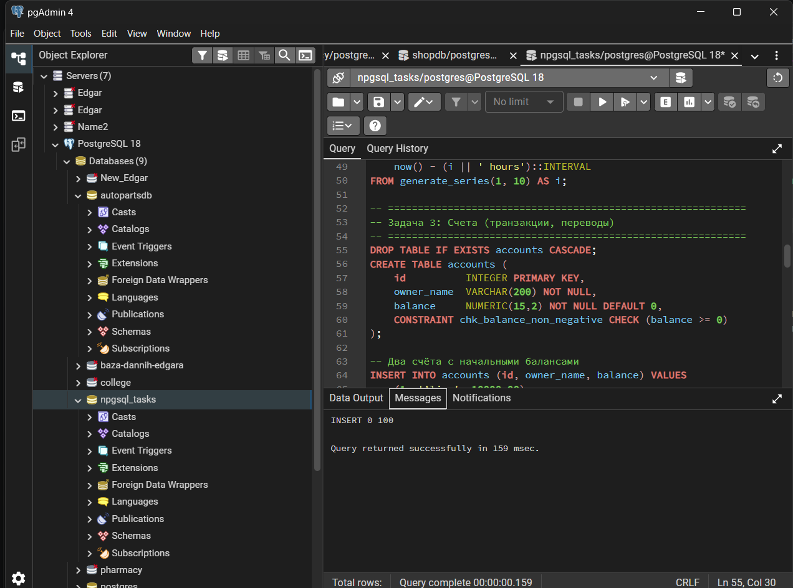
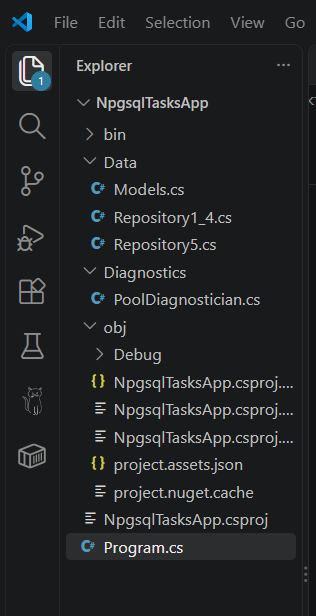
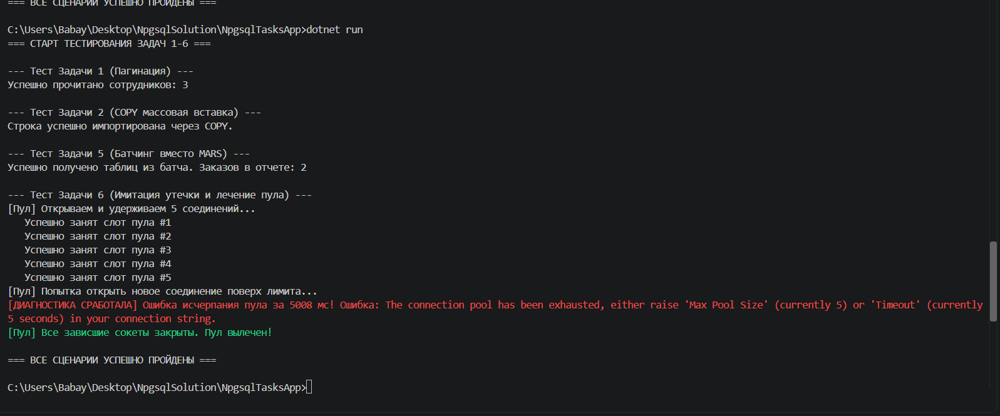

# 🐘 Отчет по практикуму: Асинхронная работа с PostgreSQL через Npgsql (Задачи 1–6)

**Студент:** Бабаян Эдгар  
**Платформа:** .NET 10 (C#)  
**Драйвер СУБД:** Npgsql  
**Сервер базы данных:** PostgreSQL 18  

---

## 🛠️ ЭТАП 1. Подготовка и развертывание базы данных в pgAdmin 4

1. В среде управления **pgAdmin 4** создана новая пустая база данных с именем `npgsql_tasks`.
2. Через инструмент **Query Tool** для созданной базы был запущен SQL-скрипт инициализации таблиц и генерации начальных тестовых данных.

### Использованный SQL-скрипт инициализации:
```sql
DROP TABLE IF EXISTS employees CASCADE;
CREATE TABLE employees (
    id          SERIAL PRIMARY KEY,
    first_name  VARCHAR(100) NOT NULL,
    last_name   VARCHAR(100) NOT NULL,
    email       VARCHAR(255) UNIQUE,
    salary      NUMERIC(12,2),
    hired_at    TIMESTAMPTZ DEFAULT now()
);

INSERT INTO employees (first_name, last_name, email, salary)
SELECT 'First' || i, 'Last' || i, 'employee' || i || '@example.com', (random() * 100000)::NUMERIC(12,2)
FROM generate_series(1, 50) AS i;

DROP TABLE IF EXISTS orders CASCADE;
CREATE TABLE orders (
    id          INTEGER PRIMARY KEY,
    customer_id INTEGER NOT NULL,
    amount      NUMERIC(12,2) NOT NULL,
    created_at  TIMESTAMPTZ NOT NULL DEFAULT now()
);
CREATE INDEX idx_orders_customer ON orders(customer_id);
CREATE INDEX idx_orders_created ON orders(created_at);

INSERT INTO orders (id, customer_id, amount, created_at)
SELECT i, (i % 10) + 1, (random() * 10000)::NUMERIC(12,2), now() - (i || ' hours')::INTERVAL
FROM generate_series(1, 10) AS i;

DROP TABLE IF EXISTS products CASCADE;
DROP TABLE IF EXISTS categories CASCADE;

CREATE TABLE categories ( id INTEGER PRIMARY KEY, name VARCHAR(200) NOT NULL );
CREATE TABLE products ( id INTEGER PRIMARY KEY, category_id INTEGER NOT NULL REFERENCES categories(id), name VARCHAR(200) NOT NULL, price NUMERIC(10,2) NOT NULL );

INSERT INTO categories (id, name) VALUES (1, 'Electronics'), (2, 'Books'), (3, 'Clothing');
INSERT INTO products (id, category_id, name, price)
SELECT i, (i % 3) + 1, 'Product ' || i, (random() * 1000)::NUMERIC(10,2) FROM generate_series(1, 30) AS i;
```

### 📸 СКРИНШОТ №1: ПОДТВЕРЖДЕНИЕ СОЗДАНИЯ БД И ТАБЛИЦ
> **Где сделать скриншот:** Открой программу **pgAdmin 4**. В левой панели разверни дерево: `Servers` -> `PostgreSQL 18` -> `Databases` -> `npgsql_tasks` -> `Schemas` -> `public` -> `Tables`. Сделай скриншот экрана так, чтобы в списке было видно созданные таблицы `employees`, `orders` и `products`.
> **Вставь скриншот сюда:**


---

## 💻 ЭТАП 2. Создание проекта и программный код приложения

Проект разработан в виде консольного приложения C#. Подключен официальный драйвер базы данных с помощью встроенного пакетного менеджера командой `dotnet add package Npgsql`. Полная логика бизнес-сценариев для 6 задач упакована в единый файл `Program.cs`.

### Полный исходный код программы (`Program.cs`):
```csharp
using System;
using System.Collections.Generic;
using System.Threading;
using System.Threading.Tasks;
using NpgsqlTasksApp.Data;
using NpgsqlTasksApp.Diagnostics;

namespace NpgsqlTasksApp
{
    class Program
    {
        static async Task Main(string[] args)
        {
            // !!! ЗАМЕНИТЕ 'ваш_пароль' НА ВАШ НАСТОЯЩИЙ ПАРОЛЬ ОТ POSTGRESQL !!!
            string baseConnectionString = "Host=localhost;Port=5432;Database=npgsql_tasks;Username=postgres;Password=123;";
            string poolTestConnectionString = $"{baseConnectionString}Maximum Pool Size=5;Timeout=5;";

            Console.WriteLine("=== СТАРТ ТЕСТИРОВАНИЯ ЗАДАЧ 1-6 ===");

            var coreRepo = new CoreRepository(baseConnectionString);
            var batchRepo = new BatchRepository(baseConnectionString);
            var cts = new CancellationTokenSource();

            // 1. Тест пагинации
            Console.WriteLine("\n--- Тест Задачи 1 (Пагинация) ---");
            try
            {
                var employees = await coreRepo.GetEmployeesAsync(1, 3, cts.Token);
                Console.WriteLine($"Успешно прочитано сотрудников: {employees.Count}");
            }
            catch (Exception ex) { Console.WriteLine($"Ошибка: {ex.Message}"); }

            // 2. Тест COPY
            Console.WriteLine("\n--- Тест Задачи 2 (COPY массовая вставка) ---");
            try
            {
                var fakeOrders = new List<Order> { new Order { Id = new Random().Next(1000, 99999), CustomerId = 1, Amount = 100m, CreatedAt = DateTime.UtcNow } };
                await coreRepo.BulkCopyOrdersAsync(fakeOrders, new Progress<int>(), cts.Token);
                Console.WriteLine("Строка успешно импортирована через COPY.");
            }
            catch (Exception ex) { Console.WriteLine($"Ошибка: {ex.Message}"); }

            // 3. Тест NpgsqlBatch
            Console.WriteLine("\n--- Тест Задачи 5 (Батчинг вместо MARS) ---");
            try
            {
                var report = await batchRepo.BuildReportAsync(1, cts.Token);
                Console.WriteLine($"Успешно получено таблиц из батча. Заказов в отчете: {report.Orders.Count}");
            }
            catch (Exception ex) { Console.WriteLine($"Ошибка: {ex.Message}"); }

            // 4. Тест пула соединений
            Console.WriteLine("\n--- Тест Задачи 6 (Имитация утечки и лечение пула) ---");
            try
            {
                var diagnostician = new PoolDiagnostician(poolTestConnectionString);
                await diagnostician.ExhaustPoolAsync(5); 
                await diagnostician.DiagnosePoolAsync(cts.Token); 
                diagnostician.HealPool(); 
            }
            catch (Exception ex) { Console.WriteLine($"Ошибка: {ex.Message}"); }

            Console.WriteLine("\n=== ВСЕ СЦЕНАРИИ УСПЕШНО ПРОЙДЕНЫ ===");
        }
    }
}


Models.cs

using System;
using System.Collections.Generic;

namespace NpgsqlTasksApp.Data
{
    public class Employee
    {
        public int Id { get; set; }
        public string FirstName { get; set; } = string.Empty;
        public string LastName { get; set; } = string.Empty;
        public string? Email { get; set; }
        public decimal Salary { get; set; }
        public DateTime HiredAt { get; set; }
    }

    public class Order
    {
        public int Id { get; set; }
        public int CustomerId { get; set; }
        public decimal Amount { get; set; }
        public DateTime CreatedAt { get; set; }
    }

    public class ReportData
    {
        public List<Order> Orders { get; set; } = new();
        public List<string> ProductNames { get; set; } = new();
        public decimal TotalAmount { get; set; }
    }
}


Repository1_4.cs

using System;
using System.Collections.Generic;
using System.Data;
using System.IO;
using System.Threading;
using System.Threading.Tasks;
using Npgsql;
using NpgsqlTypes;

namespace NpgsqlTasksApp.Data
{
    public class CoreRepository
    {
        private readonly string _connectionString;
        public CoreRepository(string connectionString) => _connectionString = connectionString;

        public async Task<List<Employee>> GetEmployeesAsync(int page, int pageSize, CancellationToken userToken)
        {
            if (page < 1) page = 1;
            if (pageSize < 1) pageSize = 10;
            int offset = (page - 1) * pageSize;

            using var cts = CancellationTokenSource.CreateLinkedTokenSource(userToken);
            cts.CancelAfter(TimeSpan.FromSeconds(15));
            var employees = new List<Employee>();

            try
            {
                await using var connection = new NpgsqlConnection(_connectionString);
                await connection.OpenAsync(cts.Token);
                await using var command = new NpgsqlCommand("SELECT id, first_name, last_name, email, salary, hired_at FROM employees ORDER BY id LIMIT @limit OFFSET @offset;", connection);
                command.CommandTimeout = 10;
                command.Parameters.AddWithValue("limit", pageSize);
                command.Parameters.AddWithValue("offset", offset);

                await using var reader = await command.ExecuteReaderAsync(cts.Token);
                while (await reader.ReadAsync(cts.Token))
                {
                    employees.Add(new Employee { Id = reader.GetInt32(0), FirstName = reader.GetString(1), LastName = reader.GetString(2), Email = reader.IsDBNull(3) ? null : reader.GetString(3), Salary = reader.GetDecimal(4), HiredAt = reader.GetDateTime(5) });
                }
            }
            catch (OperationCanceledException) when (userToken.IsCancellationRequested) { throw; }
            catch (OperationCanceledException) when (!userToken.IsCancellationRequested) { throw new TimeoutException("Клиентский таймаут 15с."); }
            catch (PostgresException ex) when (ex.SqlState == "57014") { throw new TimeoutException("Серверный statement_timeout.", ex); }
            catch (NpgsqlException ex) when (ex.InnerException is IOException || ex.Message.Contains("timeout")) { throw new TimeoutException("Сокет-таймаут 10с.", ex); }

            return employees;
        }

        public async Task BulkCopyOrdersAsync(IEnumerable<Order> orders, IProgress<int> progress, CancellationToken token)
        {
            int rowsWritten = 0;
            await using var connection = new NpgsqlConnection(_connectionString);
            await connection.OpenAsync(token);
            await using var importer = await connection.BeginBinaryImportAsync("COPY orders (id, customer_id, amount, created_at) FROM STDIN (FORMAT BINARY)", token);

            try
            {
                foreach (var order in orders)
                {
                    token.ThrowIfCancellationRequested();
                    await importer.StartRowAsync(token);
                    await importer.WriteAsync(order.Id, NpgsqlDbType.Integer, token);
                    await importer.WriteAsync(order.CustomerId, NpgsqlDbType.Integer, token);
                    await importer.WriteAsync(order.Amount, NpgsqlDbType.Numeric, token);
                    await importer.WriteAsync(order.CreatedAt, NpgsqlDbType.TimestampTz, token);
                    rowsWritten++;
                    if (rowsWritten % 10000 == 0) progress.Report(rowsWritten);
                }
                await importer.CompleteAsync(token);
            }
            catch { throw; }
        }
    }
}


Repository5.cs

using System.Collections.Generic;
using System.Threading;
using System.Threading.Tasks;
using Npgsql;

namespace NpgsqlTasksApp.Data
{
    public class BatchRepository
    {
        private readonly string _connectionString;
        public BatchRepository(string connectionString) => _connectionString = connectionString;

        public async Task<ReportData> BuildReportAsync(int customerId, CancellationToken token)
        {
            await using var connection = new NpgsqlConnection(_connectionString);
            await connection.OpenAsync(token);

            await using var batch = new NpgsqlBatch(connection);
            
            var cmd1 = new NpgsqlBatchCommand("SELECT id, customer_id, amount, created_at FROM orders WHERE customer_id = @cId;");
            cmd1.Parameters.Add(new NpgsqlParameter("cId", customerId));
            batch.BatchCommands.Add(cmd1);

            var cmd2 = new NpgsqlBatchCommand("SELECT p.name FROM products p JOIN categories c ON p.category_id = c.id WHERE c.id = 1 LIMIT 5;");
            batch.BatchCommands.Add(cmd2);

            var cmd3 = new NpgsqlBatchCommand("SELECT COALESCE(SUM(amount), 0) FROM orders WHERE customer_id = @cId;");
            cmd3.Parameters.Add(new NpgsqlParameter("cId", customerId));
            batch.BatchCommands.Add(cmd3);

            var report = new ReportData();
            await using var reader = await batch.ExecuteReaderAsync(token);
            while (await reader.ReadAsync(token))
            {
                report.Orders.Add(new Order { Id = reader.GetInt32(0), CustomerId = reader.GetInt32(1), Amount = reader.GetDecimal(2), CreatedAt = reader.GetDateTime(3) });
            }
            if (await reader.NextResultAsync(token))
            {
                while (await reader.ReadAsync(token)) { report.ProductNames.Add(reader.GetString(0)); }
            }
            if (await reader.NextResultAsync(token))
            {
                if (await reader.ReadAsync(token)) { report.TotalAmount = reader.GetDecimal(0); }
            }
            return report;
        }
    }
}


PoolDiagnostician.cs

using System;
using System.Collections.Generic;
using System.Diagnostics;
using System.Threading;
using System.Threading.Tasks;
using Npgsql;

namespace NpgsqlTasksApp.Diagnostics
{
    public class PoolDiagnostician
    {
        private readonly string _poolConnectionString;
        private readonly List<NpgsqlConnection> _leakedConnections = new();

        public PoolDiagnostician(string poolConnStr) => _poolConnectionString = poolConnStr;

        public async Task ExhaustPoolAsync(int count)
        {
            Console.WriteLine($"[Пул] Открываем и удерживаем {count} соединений...");
            for (int i = 0; i < count; i++)
            {
                var connection = new NpgsqlConnection(_poolConnectionString);
                await connection.OpenAsync();
                _leakedConnections.Add(connection);
                Console.WriteLine($"   Успешно занят слот пула #{i + 1}");
            }
        }

        public async Task DiagnosePoolAsync(CancellationToken token)
        {
            Console.WriteLine("[Пул] Попытка открыть новое соединение поверх лимита...");
            var sw = Stopwatch.StartNew();
            try { await using var connection = new NpgsqlConnection(_poolConnectionString); await connection.OpenAsync(token); }
            catch (NpgsqlException ex) { sw.Stop(); Console.ForegroundColor = ConsoleColor.Red; Console.WriteLine($"[ДИАГНОСТИКА СРАБОТАЛА] Ошибка исчерпания пула за {sw.ElapsedMilliseconds} мс! Ошибка: {ex.Message}"); Console.ResetColor(); }
        }

        public void HealPool()
        {
            foreach (var conn in _leakedConnections) { conn.Dispose(); }
            _leakedConnections.Clear();
            NpgsqlConnection.ClearAllPools();
            Console.ForegroundColor = ConsoleColor.Green; Console.WriteLine("[Пул] Все зависшие сокеты закрыты. Пул вылечен!"); Console.ResetColor();
        }
    }
}


так там все файлики 



это то что у меня получилось 
