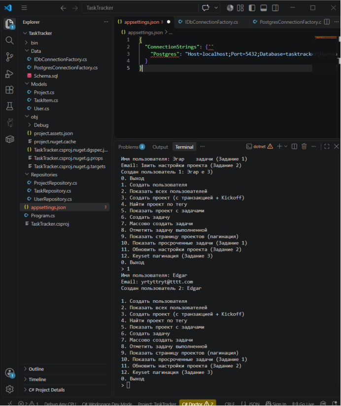

Data

IDbConnectionFactory.cs

using Npgsql;

namespace TaskTracker.Data;

public interface IDbConnectionFactory
{
    NpgsqlConnection Create();
}

PostgresConnectionFactory.cs

using Npgsql;

namespace TaskTracker.Data;

public class PostgresConnectionFactory : IDbConnectionFactory
{
    private readonly string _connectionString;

    public PostgresConnectionFactory(string connectionString)
    {
        _connectionString = connectionString;
    }

    public NpgsqlConnection Create() => new(_connectionString);
}

Schema.sql

CREATE TABLE IF NOT EXISTS users (
    id          SERIAL PRIMARY KEY,
    user_name   TEXT NOT NULL UNIQUE,
    email       TEXT NOT NULL,
    created_at  TIMESTAMPTZ NOT NULL DEFAULT now()
);

CREATE TABLE IF NOT EXISTS projects (
    id          SERIAL PRIMARY KEY,
    name        TEXT NOT NULL,
    owner_id    INT NOT NULL REFERENCES users(id) ON DELETE CASCADE,
    tags        TEXT[] NOT NULL DEFAULT '{}',
    settings    JSONB NOT NULL DEFAULT '{}'::jsonb,
    created_at  TIMESTAMPTZ NOT NULL DEFAULT now()
);

CREATE TABLE IF NOT EXISTS tasks (
    id          SERIAL PRIMARY KEY,
    project_id  INT NOT NULL REFERENCES projects(id) ON DELETE CASCADE,
    title       TEXT NOT NULL,
    is_done     BOOLEAN NOT NULL DEFAULT false,
    due_date    DATE,
    metadata    JSONB NOT NULL DEFAULT '{}'::jsonb,
    created_at  TIMESTAMPTZ NOT NULL DEFAULT now()
);

CREATE INDEX IF NOT EXISTS idx_tasks_project ON tasks(project_id);
CREATE INDEX IF NOT EXISTS idx_projects_tags ON projects USING GIN(tags);
CREATE INDEX IF NOT EXISTS idx_projects_settings ON projects USING GIN(settings);

Models

Project.cs

namespace TaskTracker.Models;

public class Project
{
    public int Id { get; set; }
    public string Name { get; set; } = "";
    public int OwnerId { get; set; }
    public string[] Tags { get; set; } = Array.Empty<string>();
    public string Settings { get; set; } = "{}";
    public DateTime CreatedAt { get; set; }
    public List<TaskItem> Tasks { get; set; } = new();
}

TaskItem.cs

namespace TaskTracker.Models;

public class TaskItem
{
    public int Id { get; set; }
    public int ProjectId { get; set; }
    public string Title { get; set; } = "";
    public bool IsDone { get; set; }
    public DateOnly? DueDate { get; set; }
    public string Metadata { get; set; } = "{}";
    public DateTime CreatedAt { get; set; }
}

User.cs

namespace TaskTracker.Models;

public class User
{
    public int Id { get; set; }
    public string UserName { get; set; } = "";
    public string Email { get; set; } = "";
    public DateTime CreatedAt { get; set; }
}

Repositories

ProjectRepository.cs

using Dapper;
using TaskTracker.Data;
using TaskTracker.Models;

namespace TaskTracker.Repositories;

public class ProjectRepository
{
    private readonly IDbConnectionFactory _factory;

    public ProjectRepository(IDbConnectionFactory factory) => _factory = factory;

    public async Task<Project> CreateAsync(string name, int ownerId, string[] tags, string settingsJson)
    {
        using var conn = _factory.Create();
        return await conn.QuerySingleAsync<Project>(@"
            INSERT INTO projects (name, owner_id, tags, settings)
            VALUES (@Name, @OwnerId, @Tags, @Settings::jsonb)
            RETURNING *",
            new { Name = name, OwnerId = ownerId, Tags = tags, Settings = settingsJson });
    }

    public async Task<List<Project>> GetByTagAsync(string tag)
    {
        using var conn = _factory.Create();
        return (await conn.QueryAsync<Project>(
            "SELECT * FROM projects WHERE @Tag = ANY(tags) ORDER BY id",
            new { Tag = tag })).ToList();
    }

    public async Task<Project?> GetWithTasksAsync(int projectId)
    {
        using var conn = _factory.Create();
        var dict = new Dictionary<int, Project>();

        await conn.QueryAsync<Project, TaskItem, Project>(@"
            SELECT p.id, p.name, p.owner_id, p.tags, p.settings, p.created_at,
                   t.id AS task_id, t.project_id, t.title, t.is_done, t.due_date, t.metadata, t.created_at AS task_created_at
            FROM projects p
            LEFT JOIN tasks t ON t.project_id = p.id
            WHERE p.id = @Id
            ORDER BY p.id, t.id",
            (project, task) =>
            {
                if (!dict.TryGetValue(project.Id, out var current))
                {
                    current = project;
                    current.Tasks = new List<TaskItem>();
                    dict.Add(current.Id, current);
                }
                if (task is not null && task.Id != 0)
                    current.Tasks.Add(task);
                return current;
            },
            new { Id = projectId },
            splitOn: "task_id");

        return dict.Values.FirstOrDefault();
    }

    public async Task<(List<Project> Items, int Total)> GetPageAsync(int page, int pageSize)
    {
        using var conn = _factory.Create();
        var offset = (page - 1) * pageSize;

        using var multi = await conn.QueryMultipleAsync(@"
            SELECT COUNT(*) FROM projects;
            SELECT * FROM projects ORDER BY id LIMIT @Limit OFFSET @Offset;",
            new { Limit = pageSize, Offset = offset });

        var total = await multi.ReadSingleAsync<int>();
        var items = (await multi.ReadAsync<Project>()).ToList();
        return (items, total);
    }

    // ЗАДАНИЕ 2: Обновление JSONB
    public async Task<Project?> UpdateSettingsAsync(int id, string jsonPatch)
    {
        using var conn = _factory.Create();
        return await conn.QuerySingleOrDefaultAsync<Project>(@"
            UPDATE projects
            SET settings = settings || @Patch::jsonb
            WHERE id = @Id
            RETURNING *",
            new { Id = id, Patch = jsonPatch });
    }

    // ЗАДАНИЕ 3: Keyset-пагинация
    public async Task<List<Project>> GetPageKeysetAsync(int lastId, int limit)
    {
        using var conn = _factory.Create();
        return (await conn.QueryAsync<Project>(@"
            SELECT * FROM projects
            WHERE id > @LastId
            ORDER BY id
            LIMIT @Limit",
            new { LastId = lastId, Limit = limit })).ToList();
    }

    // ЗАДАНИЕ 6: Транзакция создания проекта и задачи
    public async Task<(Project Project, TaskItem Kickoff)> CreateWithKickoffAsync(
        string name, int ownerId, string[] tags, string settingsJson)
    {
        using var conn = _factory.Create();
        await conn.OpenAsync();
        await using var tx = await conn.BeginTransactionAsync();

        try
        {
            var project = await conn.QuerySingleAsync<Project>(@"
                INSERT INTO projects (name, owner_id, tags, settings)
                VALUES (@Name, @OwnerId, @Tags, @Settings::jsonb)
                RETURNING *",
                new { Name = name, OwnerId = ownerId, Tags = tags, Settings = settingsJson },
                transaction: tx);

            var kickoff = await conn.QuerySingleAsync<TaskItem>(@"
                INSERT INTO tasks (project_id, title)
                VALUES (@ProjectId, 'Kickoff')
                RETURNING *",
                new { ProjectId = project.Id },
                transaction: tx);

            await tx.CommitAsync();
            return (project, kickoff);
        }
        catch
        {
            await tx.RollbackAsync();
            throw;
        }
    }

    // ЗАДАНИЕ 5: Получение нескольких проектов с задачами одним запросом
    public async Task<List<Project>> GetManyWithTasksAsync(int[] projectIds)
    {
        using var conn = _factory.Create();
        var dict = new Dictionary<int, Project>();

        await conn.QueryAsync<Project, TaskItem, Project>(@"
            SELECT p.id, p.name, p.owner_id, p.tags, p.settings, p.created_at,
                   t.id AS task_id, t.project_id, t.title, t.is_done, 
                   t.due_date, t.metadata, t.created_at AS task_created_at
            FROM projects p
            LEFT JOIN tasks t ON t.project_id = p.id
            WHERE p.id = ANY(@Ids)
            ORDER BY p.id, t.id",
            (project, task) =>
            {
                if (!dict.TryGetValue(project.Id, out var current))
                {
                    current = project;
                    current.Tasks = new List<TaskItem>();
                    dict.Add(current.Id, current);
                }
                if (task is not null && task.Id != 0)
                    current.Tasks.Add(task);
                return current;
            },
            new { Ids = projectIds },
            splitOn: "task_id");

        return dict.Values.ToList();
    }
}

TaskRepository.cs

using Dapper;
using Npgsql; // Обязательно для NpgsqlDbType в COPY
using TaskTracker.Data;
using TaskTracker.Models;
using NpgsqlTypes;
namespace TaskTracker.Repositories;

public class TaskRepository
{
    private readonly IDbConnectionFactory _factory;

    public TaskRepository(IDbConnectionFactory factory) => _factory = factory;

    public async Task<TaskItem> CreateAsync(int projectId, string title, DateOnly? dueDate, string metadataJson)
    {
        using var conn = _factory.Create();
        return await conn.QuerySingleAsync<TaskItem>(@"
            INSERT INTO tasks (project_id, title, due_date, metadata)
            VALUES (@ProjectId, @Title, @DueDate, @Metadata::jsonb)
            RETURNING *",
            new { ProjectId = projectId, Title = title, DueDate = dueDate, Metadata = metadataJson });
    }

    public async Task<TaskItem?> MarkDoneAsync(int taskId)
    {
        using var conn = _factory.Create();
        return await conn.QuerySingleOrDefaultAsync<TaskItem>(@"
            UPDATE tasks SET is_done = true
            WHERE id = @Id AND is_done = false
            RETURNING *",
            new { Id = taskId });
    }

    public async Task BulkInsertAsync(int projectId, IEnumerable<string> titles)
    {
        using var conn = _factory.Create();
        var arr = titles.ToArray();
        await conn.ExecuteAsync(@"
            INSERT INTO tasks (project_id, title)
            SELECT @ProjectId, t FROM unnest(@Titles::text[]) AS t",
            new { ProjectId = projectId, Titles = arr });
    }

    // ЗАДАНИЕ 1: Получение просроченных задач
    public async Task<List<TaskItem>> GetOverdueAsync()
    {
        using var conn = _factory.Create();
        return (await conn.QueryAsync<TaskItem>(@"
            SELECT * FROM tasks
            WHERE due_date < CURRENT_DATE AND is_done = false
            ORDER BY due_date")).ToList();
    }

    // ЗАДАНИЕ 4: Вставка через COPY (BeginBinaryImportAsync)
    public async Task BulkCopyInsertAsync(int projectId, IEnumerable<string> titles)
    {
        using var conn = _factory.Create();
        await conn.OpenAsync();

        await using var writer = await conn.BeginBinaryImportAsync(
            "COPY tasks (project_id, title) FROM STDIN (FORMAT BINARY)");

        foreach (var title in titles)
        {
            await writer.StartRowAsync();
            await writer.WriteAsync(projectId, NpgsqlTypes.NpgsqlDbType.Integer);
            await writer.WriteAsync(title, NpgsqlTypes.NpgsqlDbType.Text);
        }

        await writer.CompleteAsync();
    }
}

UserRepository.cs

using Dapper;
using TaskTracker.Data;
using TaskTracker.Models;

namespace TaskTracker.Repositories;

public class UserRepository
{
    private readonly IDbConnectionFactory _factory;

    public UserRepository(IDbConnectionFactory factory) => _factory = factory;

    // INSERT ... RETURNING — один round-trip
    public async Task<User> CreateAsync(string userName, string email)
    {
        using var conn = _factory.Create();

        return await conn.QuerySingleAsync<User>(@"
            INSERT INTO users (user_name, email)
            VALUES (@UserName, @Email)
            RETURNING id, user_name, email, created_at",
            new { UserName = userName, Email = email });
    }

    public async Task<User?> GetByIdAsync(int id)
    {
        using var conn = _factory.Create();

        return await conn.QueryFirstOrDefaultAsync<User>(
            "SELECT * FROM users WHERE id = @Id",
            new { Id = id });
    }

    public async Task<List<User>> GetAllAsync()
    {
        using var conn = _factory.Create();

        return (await conn.QueryAsync<User>(
            "SELECT * FROM users ORDER BY id")).ToList();
    }

    // UPSERT через ON CONFLICT
    public async Task<User> UpsertAsync(User user)
    {
        using var conn = _factory.Create();

        return await conn.QuerySingleAsync<User>(@"
            INSERT INTO users (id, user_name, email)
            VALUES (@Id, @UserName, @Email)
            ON CONFLICT (id) DO UPDATE
            SET user_name = EXCLUDED.user_name,
                email     = EXCLUDED.email
            RETURNING *",
            user);
    }
}

appsettings.json

{
  "ConnectionStrings": {``
    "Postgres": "Host=localhost;Port=5432;Database=tasktracker;Username=postgres;Password=123"
  }
}

Program.cs

using Microsoft.Extensions.Configuration;
using TaskTracker.Data;
using TaskTracker.Repositories;
using Dapper; // <--- ОБЯЗАТЕЛЬНО ДОЛЖНО БЫТЬ ЗДЕСЬ
// 1. Загрузка конфигурации
var config = new ConfigurationBuilder()
    .AddJsonFile("appsettings.json", optional: false)
    .Build();

// 2. Глобальная настройка маппинга snake_case
Dapper.DefaultTypeMap.MatchNamesWithUnderscores = true;

// 3. Фабрика соединений
var factory = new PostgresConnectionFactory(
    config.GetConnectionString("Postgres")!);

var users = new UserRepository(factory);
var projects = new ProjectRepository(factory);
var tasks = new TaskRepository(factory);

// 4. Проверка подключения
try
{
    using var conn = factory.Create();
    await conn.QueryAsync("SELECT 1");
    Console.WriteLine("Подключение к PostgreSQL успешно.");
}
catch (Exception ex)
{
    Console.WriteLine($"Ошибка подключения: {ex.Message}");
    return;
}

// 5. Меню
while (true)
{
   Console.WriteLine("""
        1. Создать пользователя
        2. Показать всех пользователей
        3. Создать проект (с транзакцией + Kickoff)
        4. Найти проект по тегу
        5. Показать проект с задачами
        6. Создать задачу
        7. Массово создать задачи
        8. Отметить задачу выполненной
        9. Показать страницу проектов (пагинация)
        10. Показать просроченные задачи (Задание 1)
        11. Обновить настройки проекта (Задание 2)
        12. Keyset пагинация (Задание 3)
        13. Массовая вставка через COPY (Задание 4)
        14. Показать несколько проектов с задачами (Задание 5)
        0. Выход
        """);

    Console.Write("> ");

    var choice = Console.ReadLine();

    try
    {
        switch (choice)
        {
            case "1":
                Console.Write("Имя пользователя: ");
                var userName = Console.ReadLine()!;
                Console.Write("Email: ");
                var email = Console.ReadLine()!;
                var created = await users.CreateAsync(userName, email);
                Console.WriteLine($"Создан пользователь {created.Id}: {created.UserName}");
                break;

            case "2":
                var allUsers = await users.GetAllAsync();
                foreach (var u in allUsers)
                    Console.WriteLine($"{u.Id}. {u.UserName} <{u.Email}>");
                break;

            case "3":
                Console.Write("Название проекта: ");
                var projectName = Console.ReadLine()!;
                Console.Write("ID владельца: ");
                var ownerId = int.Parse(Console.ReadLine()!);
                Console.Write("Теги через запятую: ");
                var tags = Console.ReadLine()!.Split(',', StringSplitOptions.RemoveEmptyEntries);
                var project = await projects.CreateAsync(
                    projectName, ownerId, tags, "{\"theme\":\"dark\"}");
                Console.WriteLine($"Создан проект {project.Id}: {project.Name} [{string.Join(", ", project.Tags)}]");
                break;

            case "4":
                Console.Write("Тег: ");
                var tag = Console.ReadLine()!;
                var found = await projects.GetByTagAsync(tag);
                foreach (var p in found)
                    Console.WriteLine($"{p.Id}. {p.Name}");
                break;

            case "5":
                Console.Write("ID проекта: ");
                var pid = int.Parse(Console.ReadLine()!);
                var withTasks = await projects.GetWithTasksAsync(pid);
                if (withTasks is null)
                {
                    Console.WriteLine("Проект не найден.");
                }
                else
                {
                    Console.WriteLine($"Проект: {withTasks.Name}");
                    foreach (var t in withTasks.Tasks)
                        Console.WriteLine($"  {(t.IsDone ? "✓" : "·")} {t.Id}. {t.Title}");
                }
                break;

            case "6":
                Console.Write("ID проекта: ");
                var pid2 = int.Parse(Console.ReadLine()!);
                Console.Write("Заголовок: ");
                var title = Console.ReadLine()!;
                var task = await tasks.CreateAsync(pid2, title, null, "{\"priority\":\"normal\"}");
                Console.WriteLine($"Создана задача {task.Id}");
                break;

            case "7":
                Console.Write("ID проекта: ");
                var pid3 = int.Parse(Console.ReadLine()!);
                Console.Write("Заголовки через запятую: ");
                var titles = Console.ReadLine()!.Split(',', StringSplitOptions.RemoveEmptyEntries);
                await tasks.BulkInsertAsync(pid3, titles);
                Console.WriteLine($"Вставлено {titles.Length} задач.");
                break;

            case "8":
                Console.Write("ID задачи: ");
                var tid = int.Parse(Console.ReadLine()!);
                var done = await tasks.MarkDoneAsync(tid);
                Console.WriteLine(done is null
                    ? "Задача не найдена или уже выполнена."
                    : $"Задача {done.Id} отмечена выполненной.");
                break;

            case "9":
                Console.Write("Страница: ");
                var page = int.Parse(Console.ReadLine()!);
                var (items, total) = await projects.GetPageAsync(page, 5);
                Console.WriteLine($"Всего: {total}");
                foreach (var p in items)
                    Console.WriteLine($"{p.Id}. {p.Name}");
                break;
            case "13":
                Console.Write("ID проекта: ");
                var pid5 = int.Parse(Console.ReadLine()!);
                Console.Write("Сколько задач сгенерировать? (например, 100000): ");
                var count = int.Parse(Console.ReadLine()!);
                
                var sw = System.Diagnostics.Stopwatch.StartNew();
                var generatedTitles = Enumerable.Range(1, count).Select(i => $"Задача {i}");
                await tasks.BulkCopyInsertAsync(pid5, generatedTitles);
                sw.Stop();
                
                Console.WriteLine($"Вставлено {count} задач через COPY за {sw.ElapsedMilliseconds} мс.");
                break;

            case "14":
                Console.Write("Введите ID проектов через запятую (например, 1,2,3): ");
                var idsStr = Console.ReadLine()!;
                var ids = idsStr.Split(',', StringSplitOptions.RemoveEmptyEntries)
                                .Select(int.Parse).ToArray();
                
                var manyProjects = await projects.GetManyWithTasksAsync(ids);
                foreach (var p in manyProjects)
                {
                    Console.WriteLine($"Проект: {p.Name}");
                    foreach (var t in p.Tasks)
                        Console.WriteLine($"  - {t.Title}");
                }
                break;

            case "0":
                return;

            default:
                Console.WriteLine("Неизвестная команда.");
                break;
        }
    }
    catch (Exception ex)
    {
        Console.WriteLine($"Ошибка: {ex.Message}");
    }

    Console.WriteLine();
}

TaskTracker.csproj

<Project Sdk="Microsoft.NET.Sdk">
  <PropertyGroup>
    <OutputType>Exe</OutputType>
    <TargetFramework>net8.0</TargetFramework>
    <Nullable>enable</Nullable>
    <ImplicitUsings>enable</ImplicitUsings>
  </PropertyGroup>
  <ItemGroup>
    <PackageReference Include="Dapper" Version="2.1.35" />
    <PackageReference Include="Npgsql" Version="8.0.3" />
    <PackageReference Include="Microsoft.Extensions.Configuration" Version="8.0.0" />
    <PackageReference Include="Microsoft.Extensions.Configuration.Json" Version="8.0.0" />
  </ItemGroup>
  <ItemGroup>
    <None Update="appsettings.json">
      <CopyToOutputDirectory>PreserveNewest</CopyToOutputDirectory>
    </None>
  </ItemGroup>
</Project>